# SentinelX — Network Intrusion Intelligence & ML Benchmarking Platform

**SentinelX** is a reproducible, local-first evaluation and analytics platform built for the university project **Large-Scale Network Intrusion and Threat Anomaly Detection**.

It combines:
1. **Distributed Machine Learning Benchmarking in Databricks (`databricks/Big_Data_Project.ipynb`):** Five Apache Spark MLlib binary classifiers (**Logistic Regression**, **Random Forest**, **Linear SVC**, **Gradient-Boosted Trees**, and **Multinomial Naive Bayes**) trained and evaluated across two benchmark intrusion datasets (**UNSW-NB15** and **NSL-KDD**).
2. **Interactive React + TypeScript Evaluation Dashboard (`src/`):** An 8-page offline benchmark analysis web application with multi-metric ranking, side-by-side model comparison, confusion-matrix error triage, deterministic insight generation, and CSV/JSON import/export.
3. **Power BI Analytical Suite (`powerbi/`):** Six verified analytical CSV exports, a reproducible Python aggregation and validation script (`powerbi/generate_powerbi_exports.py`), and a saved Power BI Desktop report (`powerbi/SentinelX_PowerBI.pbix`).

> **Scope & Provenance Note:** SentinelX is an **offline batch benchmark evaluation platform**. It visualizes genuine experimental outputs exported from Apache Spark MLlib on Databricks; it is not a live packet sniffer or real-time network intrusion prevention system, and the browser frontend never trains models or fabricates telemetry.

---

## Table of Contents

1. [Problem Statement & Objectives](#1-problem-statement--objectives)
2. [Key Features](#2-key-features)
3. [System Architecture](#3-system-architecture)
4. [Technology Stack](#4-technology-stack)
5. [Project Directory Structure](#5-project-directory-structure)
6. [Dataset Descriptions & Sources](#6-dataset-descriptions--sources)
7. [Dataset Download & Local Setup Instructions](#7-dataset-download--local-setup-instructions)
8. [Databricks Environment Setup](#8-databricks-environment-setup)
9. [Importing & Executing the Databricks Notebook](#9-importing--executing-the-databricks-notebook)
10. [Spark MLlib Algorithms & Preprocessing Methodology](#10-spark-mllib-algorithms--preprocessing-methodology)
11. [Verified Benchmark Results (UNSW-NB15 & NSL-KDD)](#11-verified-benchmark-results-unsw-nb15--nsl-kdd)
12. [Power BI Dashboard Setup & Instructions](#12-power-bi-dashboard-setup--instructions)
13. [React Dashboard Setup & Execution](#13-react-dashboard-setup--execution)
14. [Environment Variables & Configuration](#14-environment-variables--configuration)
15. [Dependency Installation (`npm ci` & `requirements.txt`)](#15-dependency-installation-npm-ci--requirementstxt)
16. [Troubleshooting Common Errors](#16-troubleshooting-common-errors)
17. [Repository & Contribution Context](#17-repository--contribution-context)
18. [Limitations & Future Improvements](#18-limitations--future-improvements)

---

## 1. Problem Statement & Objectives

Modern network environments generate high-volume, high-dimensional flow telemetry where distinguishing malicious intrusions from benign traffic requires scalable machine learning pipelines. However, evaluating intrusion detection classifiers solely by overall accuracy can obscure critical operational trade-offs between **False Positives** (false alarms that cause analyst fatigue) and **False Negatives** (missed intrusions).

**Project Objectives:**
- Build a unified, leakage-free **Apache Spark MLlib** preprocessing and binary classification pipeline on **Databricks** covering both legacy (`NSL-KDD`) and modern (`UNSW-NB15`) intrusion datasets (`406,190` total flow records across training and test splits).
- Benchmark five distinct classification families across **8 evaluation metrics** (`Accuracy`, `Weighted Precision`, `Weighted Recall`, `Weighted F1`, `Attack Precision`, `Attack Recall`, `Attack F1`, and `AUC-ROC`) alongside exact confusion matrix counts (`TN`, `FP`, `FN`, `TP`).
- Deliver an interactive **React/Vite web application** and **Power BI analytical suite** that allow researchers and reviewers to audit model trade-offs, inspect dataset distributions, and import/export benchmark artifacts offline.

---

## 2. Key Features

- **Genuine Databricks Experimental Integration:** Bundled with the exact 10-row benchmark (`src/data/final_benchmarks.csv`) and 10-row confusion matrix (`src/data/confusion_matrices.csv`) exports generated by Spark MLlib on Databricks.
- **8 Specialized Analytical Routes:**
  - **Overview (`/`):** Dataset-scoped KPIs, best-model spotlight, grouped bar comparisons, and a 2-model radar overlay.
  - **Model Leaderboard (`/leaderboard`):** Tie-aware competition ranking (`1-1-3`) across any of the 8 metrics, sortable columns, column-best indicators (`★`), search (`Ctrl+K`), CSV export, and a slide-over model detail drawer.
  - **Model Comparison (`/comparison`):** Multi-model selector, side-by-side metric cards, head-to-head percentage-point (`pp`) delta table, deterministic narrative summary, and 4 comparative charts.
  - **Dataset Explorer (`/datasets`):** Dataset specifications, feature catalog, attack categories, preprocessing pipeline documentation, and test-set class balance derived from verified confusion matrices.
  - **Confusion Matrix Lab (`/confusion`):** Interactive 2×2 `TP`/`FP`/`FN`/`TN` grid plus derived diagnostic metrics (`Specificity`, `FPR`, `FNR`, `NPV`, `Balanced Accuracy`, `MCC`, `Error Rate`) with division-by-zero protection.
  - **Evaluation Insights (`/insights`):** Deterministic rule-based insights highlighting metric winners, precision-recall trade-offs, and methodological cautions.
  - **Methodology (`/methodology`):** End-to-end architecture diagram, Spark MLlib pipeline stages, and interactive viva Q&A accordions.
  - **Data Import (`/import`):** Drag-and-drop CSV/JSON importer with row/column validation reporting, reset to bundled Databricks results, and local state management.
- **Global Controls & Presentation Mode:** Instant dataset scope switching (`UNSW-NB15`, `NSL-KDD`, `Compare Both`), model chip filters, light/dark themes, and full-screen **Presentation Mode** (`←` / `→` slide navigation, `Esc` to exit).
- **Strict Data Honesty Guarantees:** Missing, `NaN`, or invalid metrics are stored as `null`, displayed as `n/a` / `—`, and never coerced to zero or ranked. No synthetic geographic coordinates, live network telemetry, or LLM-hallucinated narratives are used.

---

## 3. System Architecture

```mermaid
flowchart LR
    subgraph RawData["1. Raw Benchmark Datasets (Local / Databricks Volume)"]
        U_TR["UNSW_NB15_training-set.parquet\n(175,341 rows, 36 cols)"]
        U_TE["UNSW_NB15_testing-set.parquet\n(82,332 rows, 36 cols)"]
        K_TR["KDDTrain+.txt\n(125,973 rows, 43 cols)"]
        K_TE["KDDTest+.txt\n(22,544 rows, 43 cols)"]
    end

    subgraph Databricks["2. Apache Spark MLlib Pipeline (databricks/Big_Data_Project.ipynb)"]
        PREP["StringIndexer → OneHotEncoder →\nVectorAssembler → MinMaxScaler\n(UNSW: 171 features | NSL-KDD: 122 features)"]
        MODELS["5 Spark MLlib Classifiers:\n• Logistic Regression\n• Random Forest\n• Linear SVC\n• Gradient-Boosted Trees\n• Multinomial Naive Bayes (clamped ≥ 0)"]
        PREP --> MODELS
    end

    subgraph Exports["3. Verified Experimental Exports"]
        BENCH["src/data/final_benchmarks.csv\n(10 rows × 8 metrics)"]
        CONF["src/data/confusion_matrices.csv\n(10 rows × TN, FP, FN, TP)"]
        PBI_SCRIPT["powerbi/generate_powerbi_exports.py"]
        PBI_CSVS["powerbi/*.csv\n(6 Analytical Tables)"]
    end

    subgraph Presentation["4. Interactive Visualization Layers"]
        REACT["SentinelX React Dashboard\n(Vite + TypeScript + Tailwind + Recharts)"]
        PBI_APP["Power BI Desktop Report\n(powerbi/SentinelX_PowerBI.pbix)"]
    end

    RawData --> PREP
    MODELS --> BENCH
    MODELS --> CONF
    RawData --> PBI_SCRIPT
    BENCH --> PBI_SCRIPT
    CONF --> PBI_SCRIPT
    PBI_SCRIPT --> PBI_CSVS
    BENCH --> REACT
    CONF --> REACT
    PBI_CSVS --> PBI_APP
```



---

## 4. Technology Stack

| Layer | Technology | Version / Details |
| :--- | :--- | :--- |
| **Big Data & ML Training** | Apache Spark / PySpark (`pyspark.ml`) | Databricks Runtime (Spark 3.5+ / Serverless or Standard Cluster) |
| **Frontend Framework** | React + TypeScript | React `^18.3.1`, TypeScript `~5.6.3`, Vite `^5.4.11` |
| **Routing & State** | React Router v6 + Zustand | `react-router-dom` `^6.28.0`, `zustand` `^4.5.5` (`localStorage` key `sentinelx:v1`) |
| **Styling & Motion** | Tailwind CSS + Framer Motion | `tailwindcss` `^3.4.15`, `framer-motion` `^11.11.17`, `lucide-react` `^0.460.0` |
| **Charts & CSV Parsing** | Recharts + Papa Parse | `recharts` `^2.13.3`, `papaparse` `^5.4.1` |
| **Testing** | Vitest | `vitest` `^2.1.5` (`20` unit tests in `src/utils/data.test.ts`) |
| **Local Data Processing** | Python 3 + Pandas + PyArrow + NumPy | Python `3.10+` (`numpy>=1.26.0`, `pandas>=2.1.0`, `pyarrow>=14.0.0`) |
| **BI Reporting** | Microsoft Power BI Desktop | `.pbix` report (`powerbi/SentinelX_PowerBI.pbix`) + 6 star-schema CSV exports |

---

## 5. Project Directory Structure

```text
Big_Data_Project/
├── databricks/
│   └── Big_Data_Project.ipynb               # 24-cell Databricks PySpark MLlib notebook (outputs preserved)
├── datasets/                                # Git-ignored local folder for raw benchmark datasets
│   ├── unsw-nb15/
│   │   ├── UNSW_NB15_training-set.parquet   # 175,341 rows (9,618,034 bytes) — place locally
│   │   └── UNSW_NB15_testing-set.parquet    # 82,332 rows  (4,538,929 bytes) — place locally
│   └── nsl-kdd/
│       ├── KDDTrain+.txt                    # 125,973 rows (19,109,424 bytes) — place locally
│       └── KDDTest+.txt                     # 22,544 rows  (3,441,513 bytes)  — place locally
├── powerbi/
│   ├── README.md                            # Complete Power BI data dictionary & modeling guide
│   ├── SentinelX_PowerBI.pbix               # Saved Power BI Desktop report
│   ├── generate_powerbi_exports.py          # Reproducible Python generator & validator for the 6 CSVs
│   ├── powerbi_model_benchmarks.csv         # 10 rows, 31 cols — model metrics + derived rates + ranks
│   ├── powerbi_confusion_matrix_long.csv    # 40 rows, 11 cols — unpivoted 2×2 confusion quadrants
│   ├── powerbi_dataset_split_summary.csv    # 4 rows, 13 cols  — Train/Test record & class totals
│   ├── powerbi_attack_taxonomy.csv          # 81 rows, 15 cols — attack subtypes & Unseen_In_Training flag
│   ├── powerbi_network_vectors.csv          # 2,840 rows, 14 cols — protocol/service/state aggregations
│   └── powerbi_nslkdd_difficulty.csv        # 44 rows, 10 cols — NSL-KDD difficulty_level (0–21) breakdown
├── public/
│   └── favicon.svg                          # Application icon
├── src/
│   ├── components/
│   │   ├── charts/                          # Recharts bar, radar, scatter & custom tooltip components
│   │   ├── common/                          # Dataset/metric/model controls, source badges, canvas backdrop
│   │   ├── layout/                          # AppShell (sidebar, header, command search, presentation mode)
│   │   └── ui/                              # Card, Button, Badge, Segmented, InfoTip, Overlay, Accordion
│   ├── data/
│   │   ├── final_benchmarks.csv             # Authoritative 10-row Databricks benchmark export
│   │   ├── confusion_matrices.csv           # Authoritative 10-row Databricks confusion matrix export
│   │   ├── demoData.ts                      # Parses bundled Databricks CSVs & derives test class counts
│   │   ├── datasets.ts                      # Static dataset catalog & preprocessing documentation
│   │   ├── metrics.ts                       # 8 evaluation metric definitions
│   │   ├── models.ts                        # 5 Spark MLlib classifier catalog entries
│   │   └── nav.ts                           # Route & presentation slide definitions
│   ├── hooks/                               # useBenchmarkData (memoized selectors) & useVisuals
│   ├── pages/                               # 8 route pages (Overview, Leaderboard, Comparison, etc.)
│   ├── store/                               # Zustand store (useAppStore.ts) with localStorage migration
│   ├── styles/                              # Tailwind CSS layers & theme variables
│   ├── types/                               # TypeScript interfaces
│   ├── utils/                               # CSV parser/validator, confusion math, ranking, unit tests
│   ├── App.tsx                              # Route configuration
│   └── main.tsx                             # React DOM entry point
├── .gitignore                               # Excludes node_modules/, dist/, datasets/, .venv/, __pycache__/
├── index.html                               # Vite HTML entry point
├── package.json                             # Frontend scripts and dependencies
├── package-lock.json                        # Locked npm dependency tree for reproducible `npm ci`
├── postcss.config.js                        # PostCSS configuration
├── requirements.txt                         # Python dependencies for local data processing
├── tailwind.config.js                       # Tailwind CSS configuration
├── tsconfig.json                            # TypeScript compiler configuration
└── vite.config.ts                           # Vite bundler & path alias (`@/*`) configuration
```

---

## 6. Dataset Descriptions & Sources

| Property | UNSW-NB15 | NSL-KDD |
| :--- | :--- | :--- |
| **Origin / Authors** | Australian Centre for Cyber Security (ACCS), UNSW Canberra (Moustafa & Slay, 2015) | Canadian Institute for Cybersecurity (CIC), UNB (Tavallaee et al., 2009; refined from KDD'99) |
| **Training Split** | `UNSW_NB15_training-set.parquet` — **175,341** rows (`56,000` Normal / `119,341` Attack) | `KDDTrain+.txt` — **125,973** rows (`67,343` Normal / `58,630` Attack) |
| **Testing Split** | `UNSW_NB15_testing-set.parquet` — **82,332** rows (`37,000` Normal / `45,332` Attack) | `KDDTest+.txt` — **22,544** rows (`9,711` Normal / `12,833` Attack) |
| **Total Records** | **257,673** records | **148,517** records |
| **Raw Columns** | **36** columns (`proto`, `service`, `state`, 31 numeric flow features, `attack_cat`, `label`) | **43** columns (`protocol_type`, `service`, `flag`, 38 numeric features, `label`, `difficulty_level`) |
| **Engineered Features** | **171** features after `OneHotEncoder` + `VectorAssembler` | **122** features after `OneHotEncoder` + `VectorAssembler` |
| **Attack Categories / Subtypes** | 9 attack categories (`Generic`, `Exploits`, `Fuzzers`, `DoS`, `Reconnaissance`, `Analysis`, `Backdoor`, `Shellcode`, `Worms`) + `Normal` | 22 attack subtypes in `KDDTrain+` and 37 in `KDDTest+` (17 of which are present in the test split but absent from the training split) + `normal` |

**Official Dataset Sources:**
- **UNSW-NB15:** [UNSW Canberra Cyber Range Lab — UNSW-NB15 Dataset](https://research.unsw.edu.au/projects/unsw-nb15-dataset) (Parquet distribution of the partitioned training/testing sets).
- **NSL-KDD:** [University of New Brunswick (CIC) — NSL-KDD Dataset](https://www.unb.ca/cic/datasets/nsl.html) (`KDDTrain+.txt` and `KDDTest+.txt`).

---

## 7. Dataset Download & Local Setup Instructions

To keep repository clone sizes lightweight and respect GitHub file-size limits, the raw dataset files (`~36.7 MB` total) are excluded via `.gitignore` (`datasets/`).

> **Note:** You do **not** need the raw datasets to run the **SentinelX React Dashboard** (`npm run dev`) or open the **Power BI CSV exports**, because the verified experimental outputs are already bundled in `src/data/` and `powerbi/`. You only need the raw datasets if you want to **re-run the Databricks notebook** or **re-run `python powerbi/generate_powerbi_exports.py`**.

To set up the raw datasets locally:

1. Create the dataset subdirectories inside the cloned repository root (if not already present):
   ```powershell
   mkdir -Force datasets\unsw-nb15, datasets\nsl-kdd
   ```
2. Place the four dataset files in the exact paths below:
   - `datasets/unsw-nb15/UNSW_NB15_training-set.parquet` (`9,618,034` bytes)
   - `datasets/unsw-nb15/UNSW_NB15_testing-set.parquet` (`4,538,929` bytes)
   - `datasets/nsl-kdd/KDDTrain+.txt` (`19,109,424` bytes)
   - `datasets/nsl-kdd/KDDTest+.txt` (`3,441,513` bytes)

---

## 8. Databricks Environment Setup

To reproduce the distributed Spark MLlib experiments in Databricks:

1. **Workspace:** Sign in to **Databricks** (Databricks Free Edition / Community / Standard Workspace).
2. **Compute:** Attach a cluster running **Databricks Runtime 14.x / 15.x+** (or **Serverless Compute**) with Apache Spark 3.5+. No third-party PyPI libraries need to be installed on the cluster; `pyspark.sql` and `pyspark.ml` are built into the runtime.
3. **Unity Catalog Volume Creation:**
   - In the Databricks Catalog Explorer, navigate to catalog `workspace` → schema `default`.
   - Create a Unity Catalog Volume named `network_traffic_data` so its path resolves to:
     ```text
     /Volumes/workspace/default/network_traffic_data/
     ```
4. **Upload Raw Datasets to the Volume:**
   - Upload the four raw files into `/Volumes/workspace/default/network_traffic_data/`:
     - `/Volumes/workspace/default/network_traffic_data/UNSW_NB15_training-set.parquet`
     - `/Volumes/workspace/default/network_traffic_data/UNSW_NB15_testing-set.parquet`
     - `/Volumes/workspace/default/network_traffic_data/KDDTrain+.txt`
     - `/Volumes/workspace/default/network_traffic_data/KDDTest+.txt`

---

## 9. Importing & Executing the Databricks Notebook

1. In your Databricks Workspace, click **Workspace → Import** and select `databricks/Big_Data_Project.ipynb` from this repository.
2. Attach the notebook to your Spark compute cluster.
3. Run the cells sequentially:
   - **Cell 1:** Loads the UNSW-NB15 Parquet files and NSL-KDD CSV/TXT files from `/Volumes/workspace/default/network_traffic_data/` and inspects their schemas.
   - **Cells 2–3:** Standardizes binary labels (`0.0` = Normal, `1.0` = Attack), drops non-feature targets (`id`, `attack_cat`, `difficulty_level`), fits the Spark `Pipeline` (`StringIndexer` → `OneHotEncoder` → `VectorAssembler` → `MinMaxScaler` → `VectorAssembler`) strictly on each training split (`handleInvalid="keep"`), and transforms both splits (`171` features for `UNSW-NB15`, `122` features for `NSL-KDD`).
   - **Cell 4:** Verifies exact class distributions across all four splits (`406,190` total records).
   - **Cell 5:** Runs the 5-model benchmark loop across both datasets. *(Note: In Cell 5, un-clamped `UNSW-NB15` `Naive Bayes` encounters a tiny negative scaled feature value `-3.085e-7` on the test split because a test feature fell slightly below the training minimum).*
   - **Cells 6 & 13–15:** Applies the `clamp_nonnegative` UDF (`max(0.0, float(x))`) to `unsw_train_prep` and `unsw_test_prep`, re-evaluates `Multinomial Naive Bayes` on `UNSW-NB15`, merges the corrected row into `final_benchmarks_csv`, exports `/Volumes/workspace/default/network_traffic_data/final_benchmarks_csv`, and verifies `10` rows with `0` nulls.
   - **Cells 18–23:** Extracts the `UNSW-NB15` `Naive Bayes` confusion matrix (`TN=33175, FP=3825, FN=14927, TP=30405`), combines all 10 confusion matrix records, exports `/Volumes/workspace/default/network_traffic_data/confusion_matrices_csv`, and verifies all 10 records.
4. Download the generated CSV part files from `/Volumes/workspace/default/network_traffic_data/final_benchmarks_csv` and `/Volumes/workspace/default/network_traffic_data/confusion_matrices_csv` (already saved in this repository at `src/data/final_benchmarks.csv` and `src/data/confusion_matrices.csv`).

---

## 10. Spark MLlib Algorithms & Preprocessing Methodology

### Preprocessing Pipeline (Fit on Train Only)
1. **Categorical Indexing (`StringIndexer`):** Maps `proto`, `service`, `state` (`UNSW-NB15`) and `protocol_type`, `service`, `flag` (`NSL-KDD`) to integer indices with `handleInvalid="keep"` so unseen test-split categories do not crash inference.
2. **One-Hot Encoding (`OneHotEncoder`):** Converts indexed categorical columns into sparse binary vectors.
3. **Numeric Scaling (`VectorAssembler` + `MinMaxScaler`):** Scales all numeric traffic features to `[0, 1]` using training-set extrema.
4. **Final Feature Vector (`VectorAssembler`):** Concatenates scaled numeric features and one-hot encoded categorical vectors into a single `features` column (`171` dimensions for `UNSW-NB15`; `122` dimensions for `NSL-KDD`).

### Evaluated Classifiers (`pyspark.ml.classification`)
1. **Logistic Regression (`LogisticRegression(maxIter=20)`)**
2. **Random Forest (`RandomForestClassifier(numTrees=50, maxDepth=10, seed=42)`)**
3. **Linear Support Vector Machine (`LinearSVC(maxIter=20)`)**
4. **Gradient-Boosted Trees (`GBTClassifier(maxIter=20, maxDepth=5, seed=42)`)**
5. **Multinomial Naive Bayes (`NaiveBayes(modelType="multinomial")` with `clamp_nonnegative` test-feature guard)**

---

## 11. Verified Benchmark Results (UNSW-NB15 & NSL-KDD)

All metrics below come directly from `src/data/final_benchmarks.csv` and `src/data/confusion_matrices.csv`:

### UNSW-NB15 Test Split (`82,332` Records: `37,000` Normal / `45,332` Attack)

| Model | Accuracy | Weighted Precision | Weighted Recall | Weighted F1 | Attack Precision | Attack Recall | Attack F1 | AUC-ROC | TN | FP | FN | TP |
| :--- | ---: | ---: | ---: | ---: | ---: | ---: | ---: | ---: | ---: | ---: | ---: | ---: |
| **Gradient-Boosted Trees** | **82.03%** | **85.85%** | **82.03%** | **81.14%** | 75.75% | 99.10% | **85.86%** | **97.20%** | 22,616 | 14,384 | 409 | 44,923 |
| **Random Forest** | 80.44% | 85.13% | 80.44% | 79.27% | 74.00% | **99.42%** | 84.84% | 91.34% | 21,162 | 15,838 | **265** | **45,067** |
| **Logistic Regression** | 78.73% | 81.76% | 78.73% | 77.71% | 73.56% | 95.78% | 83.21% | 89.60% | 21,398 | 15,602 | 1,914 | 43,418 |
| **Linear SVC** | 78.42% | 81.88% | 78.42% | 77.28% | 73.04% | 96.38% | 83.10% | 80.24% | 20,872 | 16,128 | 1,639 | 43,693 |
| **Naive Bayes** | 77.22% | 79.90% | 77.22% | 77.12% | **88.83%** | 67.07% | 76.43% | 69.59% | **33,175** | **3,825** | 14,927 | 30,405 |

### NSL-KDD Test Split (`22,544` Records: `9,711` Normal / `12,833` Attack)

| Model | Accuracy | Weighted Precision | Weighted Recall | Weighted F1 | Attack Precision | Attack Recall | Attack F1 | AUC-ROC | TN | FP | FN | TP |
| :--- | ---: | ---: | ---: | ---: | ---: | ---: | ---: | ---: | ---: | ---: | ---: | ---: |
| **Gradient-Boosted Trees** | **79.91%** | **84.87%** | **79.91%** | **79.77%** | **96.96%** | **66.80%** | **79.10%** | 91.18% | 9,442 | 269 | **4,261** | **8,572** |
| **Random Forest** | 77.35% | 83.49% | 77.35% | 77.06% | 96.62% | 62.39% | 75.82% | **95.12%** | 9,431 | 280 | 4,827 | 8,006 |
| **Naive Bayes** | 75.80% | 82.81% | 75.80% | 75.37% | 96.64% | 59.56% | 73.70% | 47.69% | **9,445** | **266** | 5,190 | 7,643 |
| **Logistic Regression** | 75.20% | 80.14% | 75.20% | 75.00% | 91.70% | 62.06% | 74.02% | 78.31% | 8,990 | 721 | 4,869 | 7,964 |
| **Linear SVC** | 74.43% | 79.70% | 74.43% | 74.16% | 91.55% | 60.68% | 72.98% | 87.47% | 8,992 | 719 | 5,046 | 7,787 |

---

## 12. Power BI Dashboard Setup & Instructions

All Power BI artifacts reside in `powerbi/` (see [`powerbi/README.md`](powerbi/README.md) for the complete column dictionary and relationship guide):

1. **Open the Existing Report:**
   - Open `powerbi/SentinelX_PowerBI.pbix` in **Microsoft Power BI Desktop**.
2. **Import or Refresh the Six CSV Tables:**
   - If building a new view or updating file paths in Power BI Desktop, use **Home → Get Data → Text/CSV** (or **Transform Data → Data source settings**) and point to the six CSV exports in `powerbi/`:
     - `powerbi/powerbi_model_benchmarks.csv` (`10` rows)
     - `powerbi/powerbi_confusion_matrix_long.csv` (`40` rows)
     - `powerbi/powerbi_dataset_split_summary.csv` (`4` rows — `406,190` total dataset records, `104,876` unique test records, `524,380` total model-record evaluations)
     - `powerbi/powerbi_attack_taxonomy.csv` (`81` rows — includes boolean `Unseen_In_Training`)
     - `powerbi/powerbi_network_vectors.csv` (`2,840` rows — supports protocol/state breakdowns and **Most Frequently Observed Application Services**)
     - `powerbi/powerbi_nslkdd_difficulty.csv` (`44` rows — NSL-KDD `difficulty_level` `0`–`21` breakdown)
3. **Regenerating the Power BI CSV Exports Locally (Optional):**
   - After placing the raw datasets in `datasets/` and installing `requirements.txt`, run:
     ```powershell
     python powerbi/generate_powerbi_exports.py
     ```

---

## 13. React Dashboard Setup & Execution

### Prerequisites
- **Node.js:** `v18.18+` or `v20+` / `v22+` (verified on `v22.19.0`)
- **npm:** `v9+` or `v10+` (verified on `v10.9.3`)

### Commands
```powershell
# 1. Install exact locked frontend dependencies
npm ci

# 2. Start the local Vite development server (http://localhost:5173)
npm run dev

# 3. Run TypeScript static type checking
npm run typecheck

# 4. Run the Vitest unit test suite (20 tests)
npm test

# 5. Build the production bundle into dist/
npm run build

# 6. Preview the production build locally
npm run preview
```

### Custom CSV / JSON Import Formats (`/import` page)
- **Benchmarks CSV:** `Dataset,Model,Accuracy,Weighted_Precision,Weighted_Recall,Weighted_F1,Attack_Precision,Attack_Recall,Attack_F1,AUC_ROC` (metrics on `[0, 1]` scale).
- **Confusion Matrix CSV:** `Dataset,Model,TN,FP,FN,TP` (non-negative integers).
- **Metadata JSON:** `{"datasets":[{"dataset":"NSL-KDD","train":{"normal":67343,"attack":58630},"test":{"normal":9711,"attack":12833},"description":"..."}]}`
- User imports are persisted in browser `localStorage` under key `sentinelx:v1`. Click **Reset to Bundled Databricks Results** on the `/import` page at any time to restore the default Databricks exports.

---

## 14. Environment Variables & Configuration

- **Zero Required `.env` Variables:** SentinelX runs 100% locally in the browser and requires **no API keys, database URLs, or secret tokens**.
- **Bundled Offline Assets:** Fonts (`@fontsource-variable/inter` and `@fontsource-variable/jetbrains-mono`) and experimental CSV datasets (`src/data/*.csv`) are bundled directly by Vite so the application works completely offline.

---

## 15. Dependency Installation (`npm ci` & `requirements.txt`)

### Frontend (Node.js / npm)
Use `npm ci` to install the exact dependency tree locked in `package-lock.json`:
```powershell
npm ci
```

### Local Python Scripts (`requirements.txt`)
To run `powerbi/generate_powerbi_exports.py` or inspect datasets locally with Python `3.10+`:
```powershell
python -m venv .venv
.venv\Scripts\activate
pip install -r requirements.txt
```
- `requirements.txt` installs `numpy>=1.26.0`, `pandas>=2.1.0`, and `pyarrow>=14.0.0`.
- `pyspark` is pre-installed by the **Databricks Runtime** when executing `databricks/Big_Data_Project.ipynb` on Databricks and does not need to be installed on your cluster.

---

## 16. Troubleshooting Common Errors

| Issue / Symptom | Cause | Solution |
| :--- | :--- | :--- |
| **`Naive Bayes requires nonnegative feature values` in Spark MLlib** | `MinMaxScaler` fit on training data can produce tiny negative values (e.g., `-3.085e-7`) on test data if a test feature is slightly smaller than the training minimum. | Apply the `clamp_nonnegative` UDF (`max(0.0, float(x))`) before `NaiveBayes.fit()`, as implemented in Cells 6 & 13 of `databricks/Big_Data_Project.ipynb`. |
| **`python powerbi/generate_powerbi_exports.py` reports missing files** | The raw dataset files have not been placed in `datasets/unsw-nb15/` and `datasets/nsl-kdd/`. | Follow [Section 7](#7-dataset-download--local-setup-instructions) to place the 2 Parquet files and 2 TXT files in `datasets/`. |
| **`ImportError: Unable to find a usable engine; tried using: 'pyarrow'`** | `pyarrow` is not installed in the active Python environment when reading `.parquet` files. | Run `pip install -r requirements.txt` inside your virtual environment. |
| **Dashboard shows previously uploaded custom CSV data** | Custom uploads are persisted in browser `localStorage` (`sentinelx:v1`). | Open `/import` in the dashboard and click **Reset to Bundled Databricks Results**, or clear site data in browser DevTools. |
| **Power BI file path error when refreshing CSVs** | Power Query stores absolute local paths inside `.pbix` files. | In Power BI Desktop, click **Home → Transform data → Data source settings → Change Source** and select the CSV files in your local `powerbi/` folder. |

---

## 17. Repository & Contribution Context

- **Repository:** [https://github.com/Naivedya-Shilpi/SentinalX](https://github.com/Naivedya-Shilpi/SentinalX)
- **Project:** *Large-Scale Network Intrusion and Threat Anomaly Detection* (`SentinelX`)

---

## 18. Limitations & Future Improvements

### Current Limitations
- **Single Predefined Train/Test Split:** Evaluations reflect the standard benchmark train/test partitions (`UNSW-NB15` and `NSL-KDD`) without $k$-fold cross-validation or confidence intervals.
- **No Geographical Coordinates in Source Datasets:** Both `UNSW-NB15` and `NSL-KDD` originate from anonymized synthetic laboratory testbeds and contain no IP addresses, countries, or latitude/longitude fields.
- **Binary Classification Scope in Spark MLlib:** Models were trained for binary intrusion detection (`Normal` vs. `Attack`); multi-class attack categories are analyzed descriptively in Power BI and the Dataset Explorer.

### Future Improvements
- Extend the Spark MLlib pipeline to **multi-class classification** across the 9 `UNSW-NB15` attack categories and 4 `NSL-KDD` attack families.
- Export threshold-swept ROC and Precision-Recall curve points from Databricks for interactive threshold tuning.
- Add hyperparameter cross-validation (`CrossValidator` / `TrainValidationSplit`) and feature-importance exports for tree ensembles (`Random Forest` and `GBTClassifier`).
